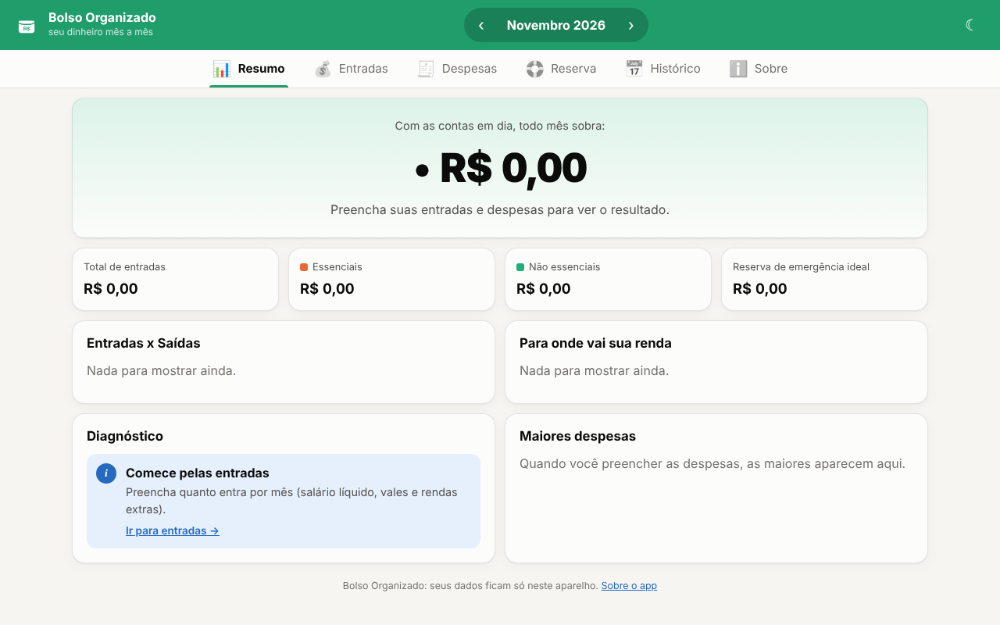

# 💚 Bolso Organizado

Organizador financeiro pessoal: anote quanto entra e quanto sai, veja **quanto sobra no fim do mês** e calcule a sua **reserva de emergência**. Funciona no celular, tablet e computador, **sem internet**, e os dados ficam só no seu aparelho.

<p>
  
</p>

## Como funciona

- **Entradas:** salário, vales e rendas extras (de uma ou de duas pessoas).
- **Despesas:** essenciais (moradia, mercado, contas…) e não essenciais (lazer, assinaturas, cartão…).
- **Sobra do mês** = entradas − despesas.
- **Reserva de emergência** = despesas essenciais × número de meses que você escolher (de 3 a 12).

## Funcionalidades

- **Totais ao vivo** enquanto você digita (barra fixa com Entradas / Despesas / Sobra).
- **Mês a mês**: navegue pelos meses, copie o mês anterior e acompanhe o **histórico** em gráfico e tabela.
- **Diagnóstico automático** do mês (déficit, nada guardado, cartão, empréstimos, tarifas).
- **Simulador de reserva de emergência**: quanto já tem, quanto vai guardar por mês, meta de 3 a 12 meses e previsão de quando chega lá.
- Itens **renomeáveis**, **removíveis** (com desfazer) e **novos itens** em qualquer grupo; busca, filtro “só preenchidas” e ordenação.
- Campo de dinheiro aceita `1.234,56`, `1234.56`, `1,5k`; Enter pula para o próximo valor.
- **Tema claro/escuro**, funciona **offline** e pode ser **instalado** no celular (PWA).
- **Backup/restauração** (.json), exportação **CSV para Excel** e **impressão/PDF**.
- **Privacidade**: tudo fica no `localStorage` do navegador; nada é enviado a servidor.

## Como rodar

Não precisa instalar nada — são arquivos estáticos (HTML, CSS e JavaScript puro).

```bash
python3 -m http.server 8000
# abra http://localhost:8000
```

Para publicar de graça: **GitHub Pages** (Settings → Pages → Deploy from branch, pasta raiz).

## App Android (APK)

A pasta [`android/`](android/) é um projeto do Android Studio que empacota o site num
**WebView**. Os arquivos do site (raiz do repositório) são copiados automaticamente
para dentro do APK a cada build — não existe cópia duplicada para manter.

**Gerar o APK:**

1. Android Studio → **File › Open** → selecione a pasta **`android/`** (não a raiz).
2. Aguarde o *Gradle Sync* (na primeira vez ele baixa o Gradle e as dependências).
3. Teste: botão ▶ **Run** num emulador ou celular.
4. APK de teste: **Build › Build App Bundle(s) / APK(s) › Build APK(s)**
   → `android/app/build/outputs/apk/debug/app-debug.apk`.
5. APK para distribuir/Play Store: **Build › Generate Signed App Bundle or APK…**
   (crie sua *keystore* e guarde-a bem — sem ela não dá para atualizar o app depois).

**Detalhes técnicos**

- Android 8.0+ (`minSdk 26`), `targetSdk 36`, Java 17, AGP 8.13, Gradle 8.14 (scripts em Groovy).
- Pacote: `br.app.organizadorfinanceiro` (troque em `android/app/build.gradle` → `applicationId`/`namespace` se quiser).
- O site é servido de `https://appassets.androidplatform.net/assets/www/` via `WebViewAssetLoader`:
  funciona **100% offline** e os dados ficam no `localStorage` do app (entram no backup automático do Android).
- Ponte JS ↔ Android (`AndroidBridge`, restrita à origem do app):
  backup e CSV abrem o seletor “Salvar em…”, “Imprimir / PDF” usa a impressão do Android,
  “Restaurar backup” abre o seletor de arquivos, o botão **voltar** retorna ao Resumo antes de sair
  e as barras do sistema acompanham o tema claro/escuro.
- Links externos abrem no navegador.
- Versão do app: `versionCode` / `versionName` em `android/app/build.gradle` — aumente a cada publicação.

## Estrutura

```
index.html            # casca da página e navegação
css/styles.css        # visual responsivo, temas claro/escuro, impressão
js/data.js            # categorias, cálculos e diagnóstico
js/app.js             # telas, interações, gráficos, exportações
sw.js                 # cache offline (só na versão web)
android/              # projeto Android Studio (WebView) que gera o APK
manifest.webmanifest  # instalação como app
icons/icon.svg
```

---

## Autor

Desenvolvido por [Josue-Caetano](https://github.com/Josue-Caetano), com auxílio de inteligência artificial no desenvolvimento.
Ferramenta de organização pessoal; não é recomendação de investimento.
